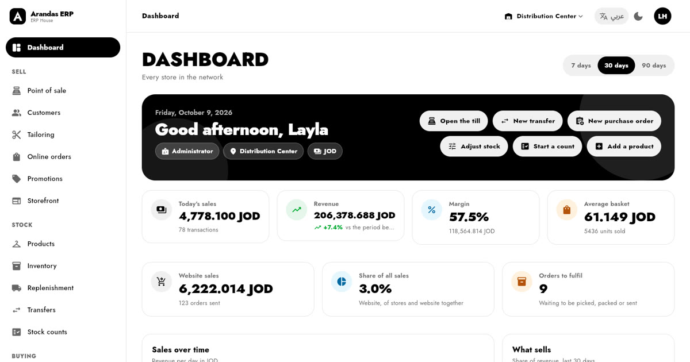
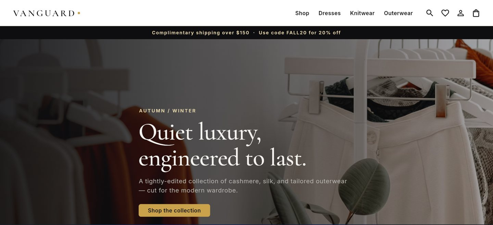
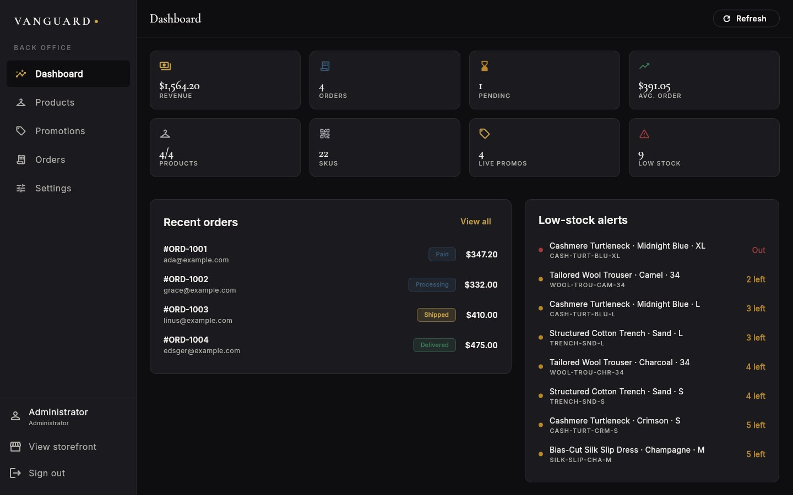

# Arandas Tech

**Software that shops and brands run on**

Point of sale · Retail ERP · Online stores · Flutter apps · Arabic and English

I'm **Ehab Arandas**, a Flutter developer in Amman, Jordan, and the founder of **Arandas Tech**. I have built apps for clients since 2021. Now we build the systems a retail business runs on: the till, the stock behind it, the online store and the apps around them.

## Products

### Arandas ERP · [source code for sale](https://erp-house.vercel.app/software)

One app that runs a fashion retailer: the online shop, a till for every branch, stock across stores, purchasing, customers and the books, on one Supabase database.

- Online shop with live stock per size, checkout, order tracking and loyalty points
- Point of sale with barcodes, split payments, returns and cash-up
- Transfers between branches, stock counts, purchase orders, dashboards and profit and loss
- 39 staff permissions, two-step sign-in, English and Arabic with right-to-left

[Try the back office](https://erp-house.vercel.app/sandbox/sign-in) (no sign-up) · [Visit the live shop](https://erp-house.vercel.app) · Get the code: [Developer licence $59](https://www.paypal.com/ncp/payment/PLB-MEBQ9L5YNMRU) · [Agency licence $199](https://www.paypal.com/ncp/payment/873ZSGENBAFQA) ([compare licences](https://erp-house.vercel.app/software#pricing))

`Flutter` `Dart` `GetX` `Supabase` `PostgreSQL`

### EA POS · [live demo](https://pos-sage-one.vercel.app)

Point of sale for shops, cafés and restaurants. Every sale is saved on the device first, so the till keeps selling when the internet drops.

- Barcode scanning, size and colour variants, split payments, parked orders and refunds
- Kitchen display, tables and open tabs, and a QR menu for customers' phones
- Receipts on thermal printers, shifts with Z-reports, stock and suppliers
- A Windows app or a browser tab, with optional live sync between tills

[Try the demo](https://pos-sage-one.vercel.app) (PIN 1234) · [Source code](https://github.com/abu-arandas/POS) · In Amman we install it for you: 14-day free trial, then 299 JOD one-off, no monthly fee. [Ask on WhatsApp](https://wa.me/962791568798?text=Hi%20Arandas%2C%20I%20would%20like%20a%20free%20EA%20POS%20trial.)

`React` `TypeScript` `Electron` `Supabase`

### Arandas Retail · private, demo on request

Retail ERP for chains with several stores and a warehouse.

- Point of sale, a stock ledger, transfers between branches, purchase orders and blind stock counts
- Customer loyalty, made-to-measure orders and fittings, and reports per store and per currency
- Several companies and currencies on one installation, with each company's data kept apart by the database
- A Flutter app for item lookup and stock counts that works offline

`TypeScript` `React` `Express` `PostgreSQL` `Flutter`

### Vanguard · [live demo](https://vanguard-demo-sigma.vercel.app)

A premium fashion store with its own back office: colour and size variants with their own price and stock, promotion codes with rules, and Stripe checkout. Flutter Web storefront and admin panel.

[Open the store demo](https://vanguard-demo-sigma.vercel.app) (no sign-up; use the "Explore back-office (demo)" chips on the sign-in page to see the admin side) · Get the code: [Regular licence $39](https://www.paypal.com/ncp/payment/PLB-NCGYHEPAJRL5) (one store you own) · [Extended licence $149](https://www.paypal.com/ncp/payment/FH5VFUK2KVTSW) (client work or SaaS)

| Storefront | Back office |
| --- | --- |
|  |  |

`Flutter Web` `Supabase`

### Foundry · private

A digital-product store whose catalogue is drafted by one AI model and graded by a different one before anything is listed, under a hard daily spending cap.

`React` `Hono` `Supabase` `Anthropic, OpenAI and Gemini models`

## What we build for clients

- Mobile apps for Android and iOS, in Flutter
- Web apps and dashboards in React and Flutter Web
- Online stores with a back office
- AI features added to existing products

Everything ships in Arabic and English, with right-to-left layouts.

## Open-source samples

| Project | What it shows |
| --- | --- |
| [tasks_app](https://github.com/abu-arandas/tasks_app) | Offline-first Flutter: SQLite, a sync queue with retries and backoff, a Kanban board, backup and restore |
| [job_board](https://github.com/abu-arandas/job_board) | A Material 3 job board with search, filters and saved jobs |
| [weather_app](https://github.com/abu-arandas/weather_app) | Forecasts for your location, hourly and 7-day, with a map |
| [recipe_app](https://github.com/abu-arandas/recipe_app) | Recipe sharing on Supabase: sign-in, photo upload, saves and follows |

## Stack

## بالعربي

**Arandas Tech** شركة برمجيات في عمّان. نبني أنظمة نقاط البيع وإدارة الفروع والمتاجر الإلكترونية وتطبيقات الجوال، بالعربي والإنجليزي.

كود **Arandas ERP** لمحلات الأزياء متاح للشراء: متجر إلكتروني وكاشير ومخزون ومشتريات وحسابات في تطبيق واحد. [جرّبه وشاهد الأسعار](https://erp-house.vercel.app/software/ar).

نظام الكاشير **EA POS** للمطاعم والكافيهات والمحلات: [جرّب الديمو](https://pos-sage-one.vercel.app)، ونركّبه عندك في عمّان مع تجربة مجانية 14 يوماً، ثم 299 ديناراً مرة واحدة بدون اشتراك شهري.

تابعنا على [فيسبوك](https://www.facebook.com/1294898037048567).

لحجز عرض تجريبي مجاني، راسلنا على [واتساب](https://wa.me/962791568798?text=%D9%85%D8%B1%D8%AD%D8%A8%D8%A7%D9%8B%D8%8C%20%D9%88%D8%B5%D9%84%D8%AA%20%D8%A5%D9%84%D9%8A%D9%83%D9%85%20%D9%85%D9%86%20GitHub%20%D9%88%D8%A3%D9%88%D8%AF%20%D8%AD%D8%AC%D8%B2%20%D8%B9%D8%B1%D8%B6%20%D8%AA%D8%AC%D8%B1%D9%8A%D8%A8%D9%8A.).

