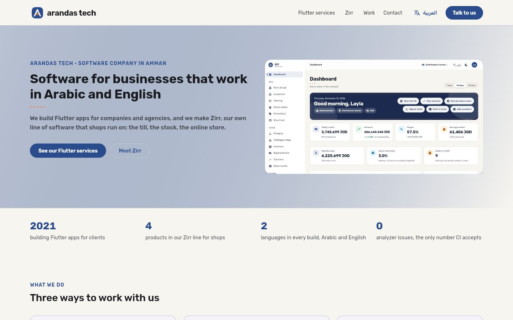
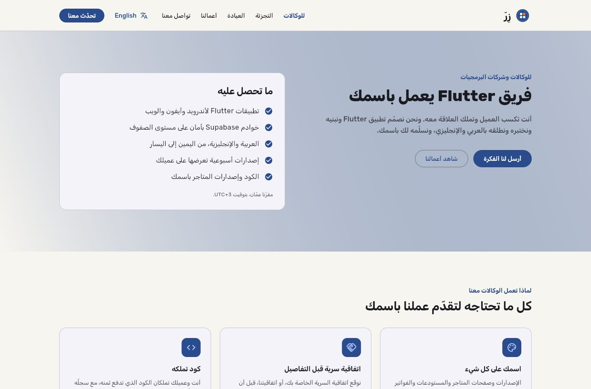
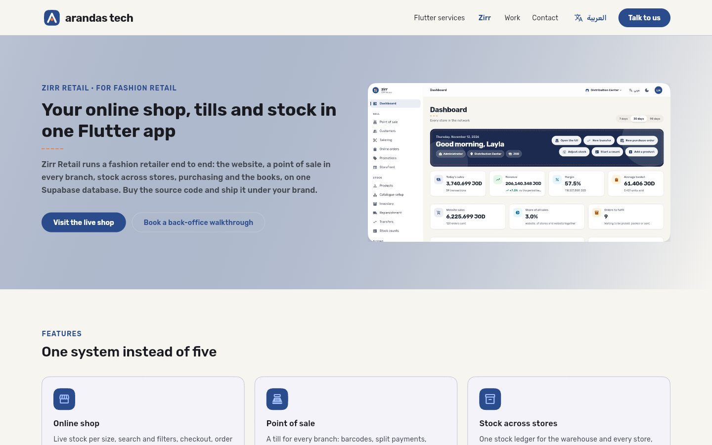
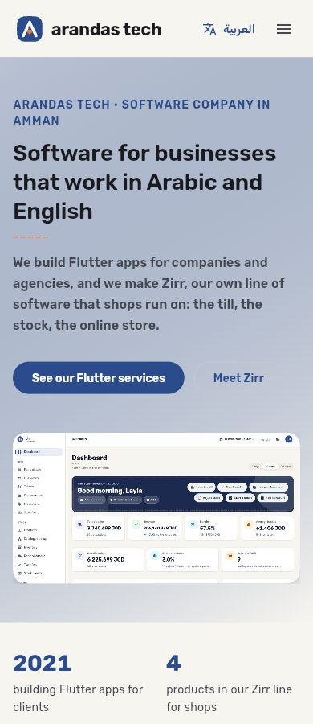

# Zirr website

The studio's own site, in Arabic and English: a white-label Flutter team for agencies, the Zirr Retail
product page, case studies from the project repositories, and a contact page. A Flutter web app built from
[zirr-starter](https://github.com/abu-arandas/zirr-starter)'s structure and rules. It needs no backend and no keys.

| Home | For agencies (Arabic) |
| --- | --- |
|  |  |

| Zirr Retail | Phone |
| --- | --- |
|  |  |

## Pages

| Address | Page |
| --- | --- |
| `/` | Home: services, products, quality bar, recent case studies |
| `/agencies` | The white-label Flutter team: benefits, ways to work, process, FAQ |
| `/products/retail` | Zirr Retail (the ERP repository): features, what is in the box, licences with PayPal links |
| `/work`, `/work/<slug>` | Case studies: `retail`, `vanguard` (Zirr Boutique), `starter`; Zirr POS as another product |
| `/contact` | A form that opens WhatsApp with the visitor's message written, and the other links |

The site opens in Arabic when the visitor's browser asks for Arabic, otherwise in English; the button in the header
switches. Any other address shows the not-found page.

## Changing what it says

- **Text, offers, case studies, FAQ:** [`lib/config/content.dart`](lib/config/content.dart), in English.
- **Arabic:** [`lib/l10n/ar.dart`](lib/l10n/ar.dart), keyed by the English. `node tool/check_arabic.mjs` fails when a text has
  no Arabic, or when an Arabic entry is left over.
- **Name, colour, font, WhatsApp, email, social links:** [`lib/config/brand.dart`](lib/config/brand.dart). Set
  `Brand.email` once the studio has its own address; the contact page shows it then.
- **Testimonials:** add them to `Content.testimonials` once clients agree to be quoted; the section appears by itself.
- **Pictures:** `assets/images`.
- **Page title and link previews:** `web/index.html`.

## Motion and voice

The site is a marketing page, so it moves the most of all the Zirr apps, and everything is built from
[`lib/widgets/motion.dart`](lib/widgets/motion.dart) with the durations and curves in `AppTheme`
([`lib/config/theme.dart`](lib/config/theme.dart)); a widget never sets its own.

- **On load:** while Flutter boots, the Zirr button presses itself in with a rotating line in the visitor's language
  (`web/index.html`). Then the header slides down (first page only), the hero's title rises word by word, its orange
  stitch sews itself in and the picture is unveiled, all within about a second.
- **On scroll:** each band's heading rises word by word and its contents follow; cards come in a step apart; the
  figures on the home and Retail pages roll to their real values (the analyzer count counts down to zero). Each
  plays once.
- **Under the pointer:** cards lift onto a soft shadow, price and case study cards lean toward the pointer, pictures
  lean in, icons give a little shake, footer links draw an orange underline, the main buttons are drawn to the
  pointer and every button gives a little when pressed.
- **Fun:** press the logo five times in a row for a shower of buttons and a thank-you line; the not-found page has a
  lost button that rolls in, with one of a few lines ([`lib/widgets/fun.dart`](lib/widgets/fun.dart)); sending the
  contact form bursts confetti from the button; the footer signs off "Made in Amman, one button at a time."
- **Never:** jokes on prices, licences, the contact form's errors or anything legal. Arabic lines are written
  separately in [`lib/l10n/ar.dart`](lib/l10n/ar.dart), not translated word for word.
- **Reduce motion:** with the system's reduce-motion setting on, every page is simply there, still.

## Run and check

Flutter 3.50.0, the version CI and `tool/vercel_build.sh` use.

```bash
flutter pub get
flutter run -d chrome
dart format lib tool && flutter analyze && tool/check_layers.sh && node tool/check_arabic.mjs
```

Open each page at a phone's and a laptop's width in both languages before you deploy: no check does that for you.

## Deploy on Vercel

Import the `abu-arandas` repository as a new project and set **Root Directory** to `site`. `vercel.json` runs
`tool/vercel_build.sh` (which fetches Flutter), serves `build/web`, sends every unknown path to `index.html` and adds
the headers the WebAssembly build needs. No environment variables. Locally, `node tool/serve.mjs 8080` serves a build
the same way.
