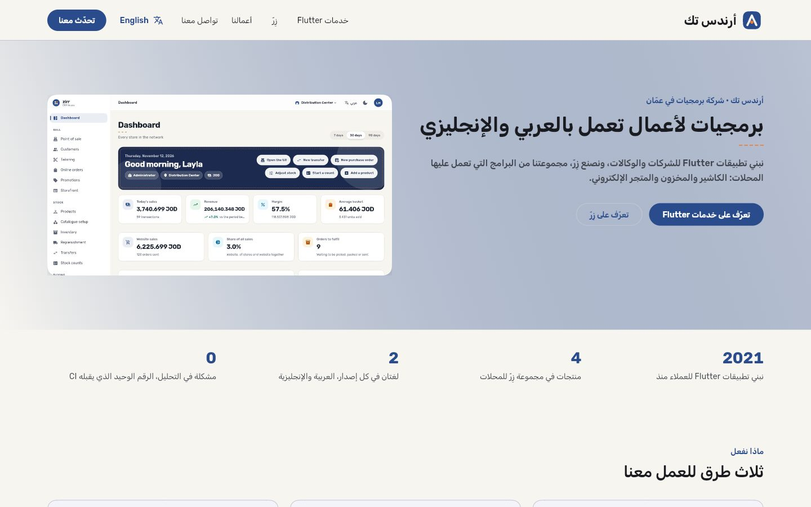
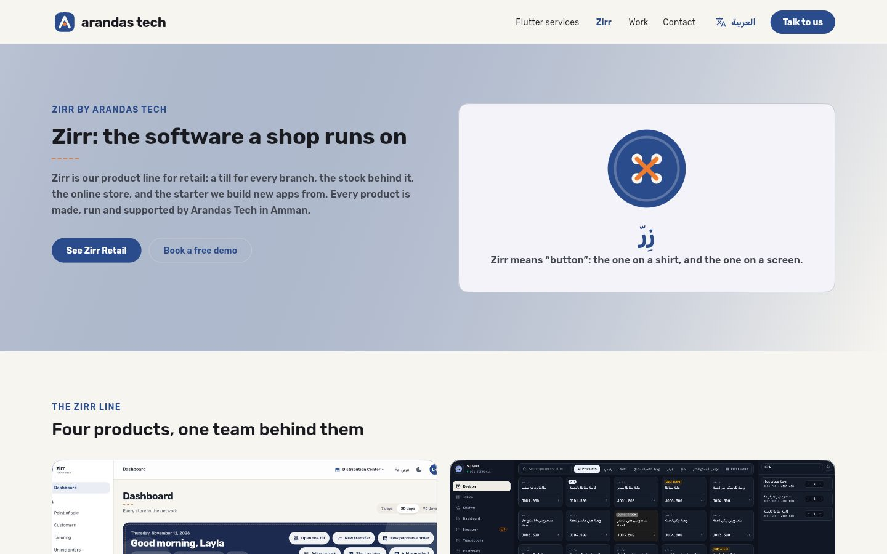
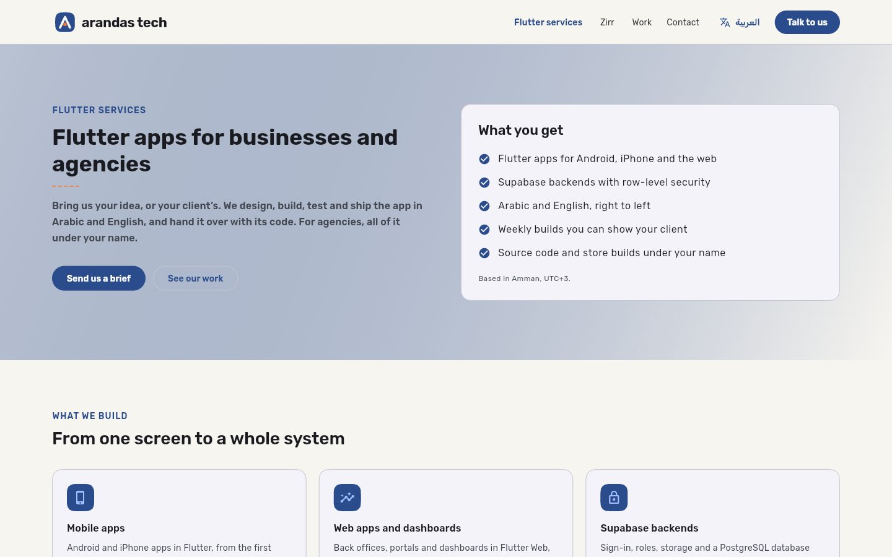

# Arandas Tech website

The company's own site, in Arabic and English: Arandas Tech's Flutter services for businesses and agencies, the Zirr
product line (Zirr Retail, Zirr POS, Zirr Boutique, Zirr Starter), case studies and a contact page. A Flutter web app
built from Zirr Starter's structure and rules. It needs no backend and
no keys. Live at https://arandas.tech.

| Home | Home (Arabic) |
| --- | --- |
|  |  |

| Zirr | Flutter services |
| --- | --- |
|  |  |

## Pages

| Address | Page |
| --- | --- |
| `/` | Home: what we do, the Zirr line, quality bar, recent case studies |
| `/services` | Flutter services: what we build, the white-label team for agencies, ways to work, process, FAQ (`/agencies` still opens it) |
| `/zirr` | The Zirr line: what the name means, the four products, why shops pick it |
| `/zirr/retail` | Zirr Retail: features, what is in the box, licences with PayPal links (`/products/retail` still opens it) |
| `/work`, `/work/<slug>` | Case studies: `retail`, `vanguard` (Zirr Boutique), `starter`; then the Zirr line |
| `/contact` | A form that opens WhatsApp with the visitor's message written, and the other links |

The site opens in Arabic when the visitor's browser asks for Arabic, otherwise in English; the button in the header
switches. Any other address shows the not-found page.

## Brand

Arandas Tech (العرندس للتكنولوجيا) is the company; Zirr (زِرّ, "button") is its product line for shops. The company's
palette is deep teal #0E5E6F, saffron #E8A33D (always with dark text), ink #121417 and warm sand #F5F1EA, set in
`lib/config/brand.dart`, with the Rubik font. The logo is a wordmark: the name in bold ink with one saffron pixel over
the "a" of "das", drawn in `lib/widgets/site_scaffold.dart` (`_Wordmark`); the lockups are in `../assets/brand/`
(`arandas-tech.png`, `arandas-tech-on-dark.png`). The small monogram, a sand A on a teal tile with the pixel for its
crossbar, is the favicon (`web/favicon.svg`, the icons in `web/icons/`) and the boot screen in `web/index.html`. The
Zirr button (`ZirrButton` in `lib/widgets/fun.dart`) stays the mark of the Zirr line.
The pictures on the company's Facebook page and Google Business profile are in `../assets/brand/social/`
(`profile-picture.png`, the monogram at 1000 px; `facebook-cover.png`, 851x315); Google's cover is `web/og.jpg`.

## Changing what it says

- **Text, offers, case studies, FAQ:** [`lib/config/content.dart`](lib/config/content.dart), in English.
- **Arabic:** [`lib/l10n/ar.dart`](lib/l10n/ar.dart), keyed by the English. `node tool/check_arabic.mjs` fails when a text has
  no Arabic, or when an Arabic entry is left over.
- **Name, product line, colour, font, WhatsApp, email, social links:** [`lib/config/brand.dart`](lib/config/brand.dart).
  Set `Brand.email` once the company has its own address; the contact page shows it then.
- **Testimonials:** add them to `Content.testimonials` once clients agree to be quoted; the section appears by itself.
- **Pictures:** `assets/images`.
- **Page title, link previews and company details for Google:** `web/index.html`. The preview picture `web/og.jpg` is
  drawn by `python3 tool/og_image.py`; run it again after changing the name or colours.
- **Pages Google should list:** `web/sitemap.xml` (add a page there when you add a route).

## Motion and voice

The site is a marketing page, so it moves the most of all our apps, and everything is built from
[`lib/widgets/motion.dart`](lib/widgets/motion.dart) with the durations and curves in `AppTheme`
([`lib/config/theme.dart`](lib/config/theme.dart)); a widget never sets its own.

- **On load:** while Flutter boots, the Arandas Tech mark presses itself in with a rotating line in the visitor's language
  (`web/index.html`). Then the header slides down (first page only), the hero's title rises word by word, its orange
  stitch sews itself in and the picture is unveiled, all within about a second.
- **On scroll:** each band's heading rises word by word and its contents follow; cards come in a step apart; the
  figures on the home and Retail pages roll to their real values (the analyzer count counts down to zero). Each
  plays once.
- **Under the pointer:** cards lift onto a soft shadow, price and case study cards lean toward the pointer, pictures
  lean in, icons give a little shake, footer links draw an orange underline, the main buttons are drawn to the
  pointer and every button gives a little when pressed.
- **Fun:** press the logo five times in a row for a shower of Zirr buttons and a thank-you line; the Zirr button on
  the Zirr page wiggles when pressed and says something back; the not-found page has a
  lost button that rolls in, with one of a few lines ([`lib/widgets/fun.dart`](lib/widgets/fun.dart)); sending the
  contact form bursts confetti from the button; the footer signs off "Made in Amman, one button at a time."
- **Never:** jokes on prices, licences, the contact form's errors or anything legal. Arabic lines are written
  separately in [`lib/l10n/ar.dart`](lib/l10n/ar.dart), not translated word for word.
- **Reduce motion:** with the system's reduce-motion setting on, every page is simply there, still.

## Run and check

Flutter 3.50.0, the version CI and `tool/vercel_build.sh` use.

```bash
flutter pub get
flutter run -d chrome
dart format lib tool && flutter analyze && tool/check_layers.sh && node tool/check_arabic.mjs
```

Open each page at a phone's and a laptop's width in both languages before you deploy: no check does that for you.

## Deploy on Vercel

Import the `abu-arandas` repository as a new project and set **Root Directory** to `site`. `vercel.json` runs
`tool/vercel_build.sh` (which fetches Flutter), serves `build/web`, sends every unknown path to `index.html` and adds
the headers the WebAssembly build needs. No environment variables. Locally, `node tool/serve.mjs 8080` serves a build
the same way.
