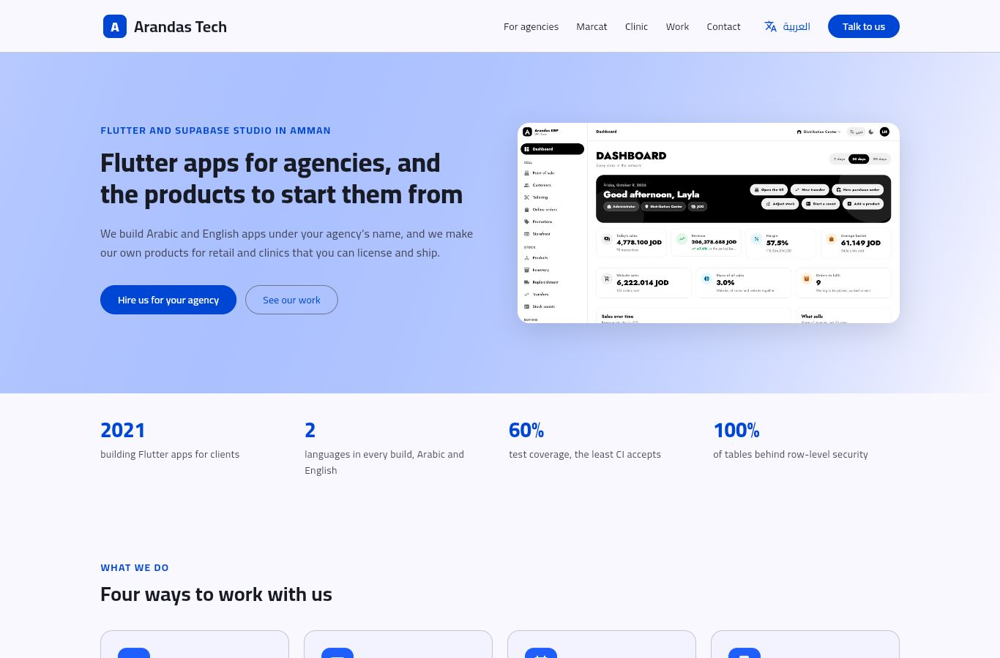
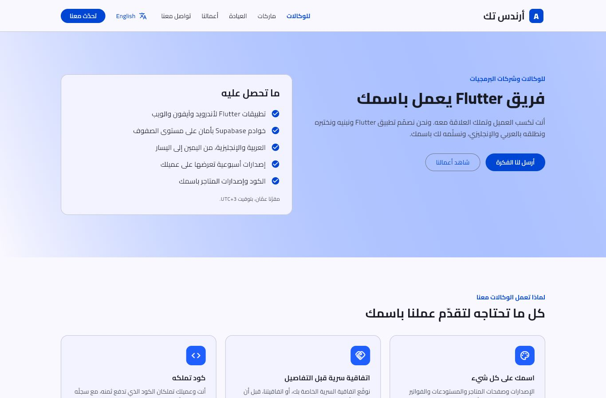
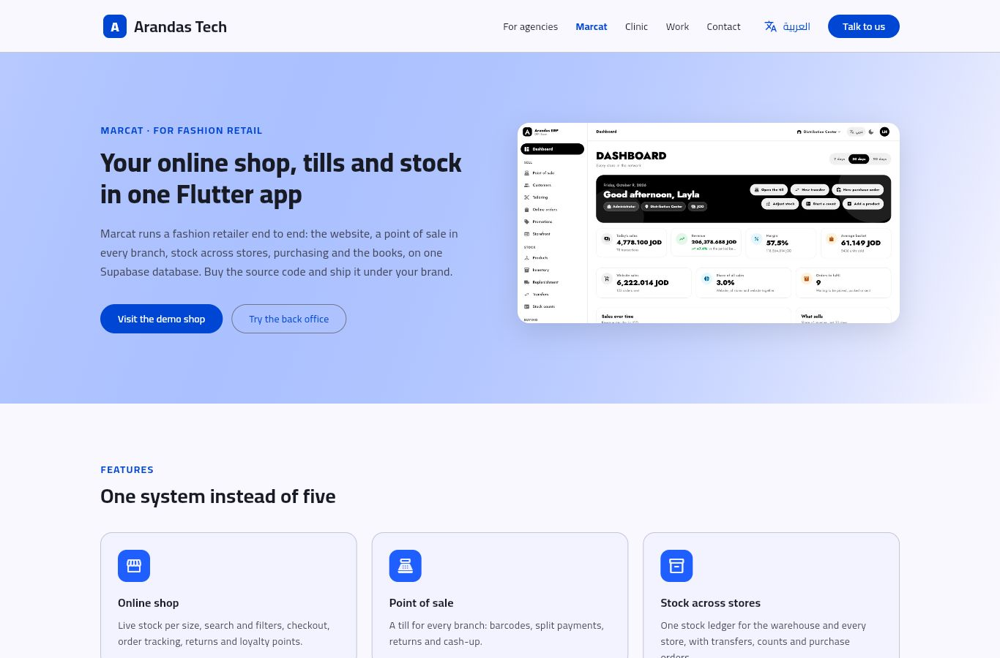
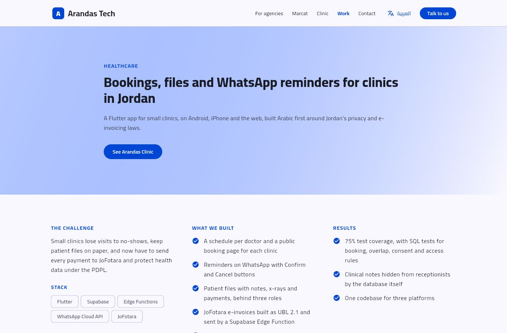
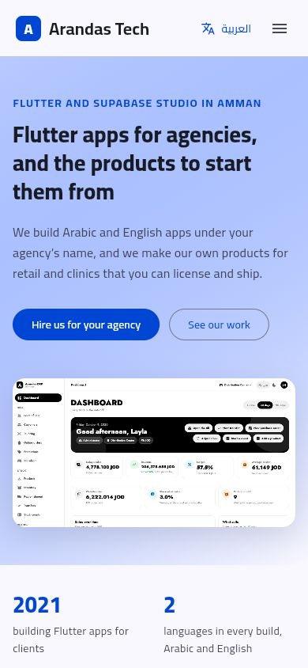

# Arandas Tech website

The studio's own site, in Arabic and English: a white-label Flutter team for agencies, the Marcat and Arandas Clinic
product pages, case studies from the project repositories, and a contact page. A Flutter web app built from
[arandas-starter](https://github.com/abu-arandas/arandas-starter)'s structure and rules. It needs no backend and no keys.

| Home | For agencies (Arabic) |
| --- | --- |
|  |  |

| Marcat | Clinic | Phone |
| --- | --- | --- |
|  |  |  |

## Pages

| Address | Page |
| --- | --- |
| `/` | Home: services, products, quality bar, recent case studies |
| `/agencies` | The white-label Flutter team: benefits, ways to work, process, FAQ |
| `/products/marcat` | Marcat (the ERP repository): features, what is in the box, licences with PayPal links |
| `/products/clinic` | Arandas Clinic: features and the PDPL privacy measures |
| `/work`, `/work/<slug>` | Case studies: `marcat`, `clinic`, `vanguard`, `starter`; EA POS as another product |
| `/contact` | A form that opens WhatsApp with the visitor's message written, and the other links |

The site opens in Arabic when the visitor's browser asks for Arabic, otherwise in English; the button in the header
switches. Any other address shows the not-found page.

## Changing what it says

- **Text, offers, case studies, FAQ:** [`lib/config/content.dart`](lib/config/content.dart), in English.
- **Arabic:** [`lib/l10n/ar.dart`](lib/l10n/ar.dart), keyed by the English. `flutter test` fails when a text has no
  Arabic, or when an Arabic entry is left over.
- **Name, colour, font, WhatsApp, email, social links:** [`lib/config/brand.dart`](lib/config/brand.dart). Set
  `Brand.email` once the studio has its own address; the contact page shows it then.
- **Testimonials:** add them to `Content.testimonials` once clients agree to be quoted; the section appears by itself.
- **Pictures:** `assets/images`. The clinic has no screenshot yet; a sketch of its Today screen stands in.
- **Page title and link previews:** `web/index.html`.

## Run and check

Flutter 3.47.7, the version CI and `tool/vercel_build.sh` use.

```bash
flutter pub get
flutter run -d chrome
dart format lib test && flutter analyze && flutter test --coverage && tool/check_coverage.sh 60
```

The tests open every page at a phone's and a laptop's width, in both languages, with the real font, and fail on any
overflow.

## Deploy on Vercel

Import the `abu-arandas` repository as a new project and set **Root Directory** to `site`. `vercel.json` runs
`tool/vercel_build.sh` (which fetches Flutter), serves `build/web`, sends every unknown path to `index.html` and adds
the headers the WebAssembly build needs. No environment variables. Locally, `node tool/serve.mjs 8080` serves a build
the same way.
